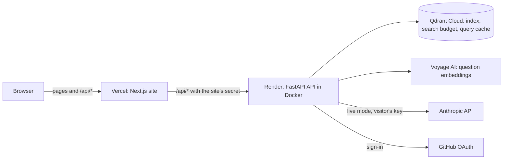

# GradPath AI

An AI career-preparation app for new graduates. Give it a job description and your profile, and it
builds an evidence-backed preparation roadmap: the role's requirements, a skills-gap analysis with
confidence levels, prioritised learning steps with cited resources, and practice questions.

It is a portfolio project that demonstrates adaptive RAG: a router sends focused questions through a
single retrieval-and-generation pass, and multi-step requests (analyse this job against my profile and
plan my preparation) through a LangGraph agentic workflow. Both share one retrieval service, and both
are measured with a labelled evaluation set.

> Status: Milestones 0-7 are done, and Milestone 8 (deploy) is live on free tiers. Next: a
> provider layer so visitors can also use local models (Ollama, LM Studio, in-browser models).
> The milestone story is in `brain/work/MILESTONES.md`.

## Try it
**[gradpath-ai-phi.vercel.app](https://gradpath-ai-phi.vercel.app)**

- **No account, no key:** replay 8 recorded runs (cited answers, a "not covered" answer, a job
  analysis, a full plan) made with a sample posting and a fictional profile, and search the
  knowledge base live (the retrieval half of RAG, no model call).
- **Live mode:** Sign in with GitHub (accounts at least 30 days old), then paste your own
  Anthropic API key to run the real app. The key stays in the page's memory, travels over HTTPS
  with each request, and is never stored, logged or traced. A sign-in lasts one day.
- **First visit after a quiet spell:** the free server sleeps after 15 idle minutes. The site shows
  a "waking up" screen while it starts (usually under a minute) and offers "Try again" if it takes
  longer than 3 minutes.

## What you can do
| Screen | What it does |
|---|---|
| Ask (`/`) | Ask a backend preparation question and get an answer with citations, or a clear "not covered". Add a job posting and a profile and the router sends it to the full workflow instead. |
| Analyse a job (`/job`) | Paste a posting: each requirement with its coverage in the knowledge base, the quote from the posting, a study note and its sources. |
| Plan (`/plan`) | Posting + profile -> skills gap, roadmap with cited resources, interview questions. Runs in the background (1.5-5 min) with live stage progress; partial results are labelled as partial. |
| Profile (`/profile`) | Your profile, kept only in this browser; can be filled from pasted resume text. |
| Search sources (`/search`) | Find passages in the curated sources that match a question, with no model call. |

Ask, Analyse a job and Plan each offer their recorded examples; in live mode they (and the resume
import on Profile) run on your key.

## Stack
Python 3.13 · FastAPI · LangGraph · LangChain · Claude (Anthropic) · Voyage AI embeddings · Qdrant ·
LangSmith tracing and evaluation · Next.js + Tailwind CSS · Docker · GitHub Actions.

## Modes
| Mode (`APP_MODE`) | Where | Model calls |
|---|---|---|
| `local` | Your machine | Claude through Claude Code on your own Claude plan, or the Anthropic API with your key |
| `demo` (the default) | Any server | None: replays the recorded runs; source search when the server has a Voyage key; needs no keys |
| `live` | The deployed site | The visitor's own Anthropic key, per request, after Sign in with GitHub |

`APP_MODE` defaults to `demo`, the safe choice for a server: the model routes answer 403 and only
the recorded examples (`/api/demo`) and source search are served. Set `APP_MODE=local` in `.env`
to run models on your own machine (`.env.example` already does).

## How it is deployed
All free tiers, no payment method.



- The browser only talks to the site. The site forwards `/api/*` to the API with a shared secret,
  and the API refuses every request without it (except its health check), so it can't be called
  directly.
- Search spends the owner's Voyage key, so it has a site-wide daily budget stored in Qdrant, a
  cache of repeated questions, and per-network rate limits. Live mode adds per-network and
  per-GitHub-user limits on model calls.
- CI (GitHub Actions) runs lint and tests for both halves, builds the API image, starts it with no
  keys, and scans it with Trivy. Threats and defences are in `brain/engineering/SECURITY.md`.

## Setup
Needs [uv](https://docs.astral.sh/uv/) and Python 3.13.

```bash
cp .env.example .env          # then fill in the keys you have (APP_MODE=local); demo mode needs none
cd backend
uv sync
uv run pytest -q              # no keys or network needed
uv run pytest --html=reports/tests.html --self-contained-html   # report to open in a browser
```

**Local live mode on your Claude plan** (`LLM_PROVIDER=claude_code`): the Claude Agent SDK ships
its own Claude Code CLI. Log in once from a normal terminal (not one running inside Claude Code):

```bash
.venv/Lib/site-packages/claude_agent_sdk/_bundled/claude.exe   # Windows; type /login, then /exit
uv run python -m gradpath.providers.smoke                      # one tiny real call
```

Make sure `ANTHROPIC_API_KEY` is not set in your shell, or Claude Code bills the API instead of your
plan. To use the API instead, set `LLM_PROVIDER=anthropic_api` and `ANTHROPIC_API_KEY` in `.env`.

## Run the app locally
Needs Node.js 20.9 or newer for the frontend. Build the knowledge-base index once (needs
`VOYAGE_API_KEY` in `.env`; it caches embeddings, so a re-run doesn't spend tokens again):

```bash
cd backend
uv run python -m gradpath.ingestion.ingest
```

Then start the API and the frontend in two terminals:

```bash
cd backend
uv run uvicorn gradpath.api.main:app        # API on http://127.0.0.1:8000 (docs at /docs; not reachable on the deployed site)
```

```bash
cd frontend
npm ci
npm run dev                                  # http://localhost:3000; /api/* goes to the API
```

Local Qdrant allows one process at a time: stop the API before running ingest or an evaluation.
Frontend checks: `npm run lint && npm run typecheck && npm test && npm run build`.

### Run the API in Docker
The API also ships as a Docker image (the one the deployed site runs). With Docker Desktop
installed, from the repo root:

```bash
docker build -f backend/Dockerfile -t gradpath-api .
docker run --rm -p 8000:8000 gradpath-api   # demo mode: recorded runs, no keys needed
```

Keys are never built into the image; pass settings at run time (for example `-e APP_MODE=...`).
The image has no local index, so modes that search need `QDRANT_URL` pointing at a Qdrant server.

## Documentation
Everything else lives in `brain/`:
- `brain/product/REQUIREMENTS.md`: goal, scope, owner decisions
- `brain/engineering/ARCHITECTURE.md`: how it works, modes, deploy
- `brain/engineering/EVALUATION.md`: retrieval, routing and answer evaluations with results
- `brain/engineering/SECURITY.md`: threat model and release checklist
- `brain/work/MILESTONES.md`: what was built, milestone by milestone
